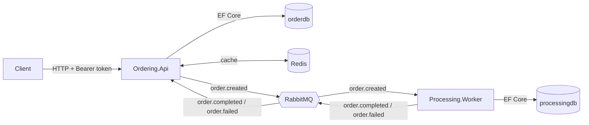

# OrderCase

Kullanıcıdan sipariş alan, siparişi RabbitMQ üzerinden ayrı bir işleme servisine gönderen ve sonucu asenkron olarak geri alan, iki servisli bir .NET 10 mikroservis örneği.

Öne çıkanlar: Clean Architecture, CQRS (MediatR), Outbox pattern ve retry (DotNetCore.CAP), Redis cache, servisler arası uçtan uca correlation ID ile loglama (Serilog), token tabanlı kimlik doğrulama ve rol bazlı yetkilendirme, soft delete ve audit, tamamen Docker üzerinde çalışan kurulum.

---

## İçindekiler

- [Hızlı başlangıç](#hızlı-başlangıç)
- [Mimari](#mimari)
- [API](#api)
- [Tasarım kararları](#tasarım-kararları)
- [Test senaryoları](#test-senaryoları)
- [Lokal geliştirme](#lokal-geliştirme)
- [Bilinen sınırlamalar ve geliştirme önerileri](#bilinen-sınırlamalar-ve-geliştirme-önerileri)

---

## Hızlı başlangıç

Gereksinim: Docker Desktop.

```bash
docker compose up -d --build
```

İlk build birkaç dakika sürer. Servisler açılırken veritabanları migration'larla otomatik oluşturulur; CAP tabloları ve RabbitMQ queue'ları da kendiliğinden kurulur.

| Ne | Adres |
|---|---|
| Swagger UI | http://localhost:8080/swagger |
| CAP Dashboard | http://localhost:8080/cap |
| RabbitMQ Management | http://localhost:15673 (`guest` / `guest`) |
| PostgreSQL | `localhost:5432` (`postgres` / `postgres`), veritabanları: `orderdb`, `processingdb` |
| Redis | `localhost:6379` |

Logları izlemek için:

```bash
docker compose logs -f ordering-api processing-worker
```

Her şeyi sıfırlamak için (veritabanları dahil):

```bash
docker compose down -v
```

### Test token'ları

Swagger'da sağ üstteki **Authorize** butonuna token'ı `Bearer` öneki olmadan girin.

| Token | Kullanıcı | Rol |
|---|---|---|
| `admin-token-123` | `admin-1` | Admin |
| `user-token-123` | `user-1` | User |
| `user-token-456` | `user-2` | User |

### Örnek istek

```bash
curl -i -X POST http://localhost:8080/api/orders \
  -H "Authorization: Bearer user-token-123" \
  -H "Content-Type: application/json" \
  -d '{"userId":"user-1","productId":"product-42","quantity":2,"paymentMethod":"CreditCard"}'
```

Cevap `202 Accepted` döner; `Location` header'ı siparişin durumunun sorgulanacağı adresi gösterir. Birkaç saniye sonra:

```bash
curl http://localhost:8080/api/orders/{orderId} -H "Authorization: Bearer user-token-123"
```

`status` alanı `Pending` → `Completed` (veya `Failed`) olarak değişir.

---

## Mimari



### Akış

1. **Ordering.Api** isteği doğrular, siparişi `Pending` olarak kaydeder ve `order.created` event'ini **aynı transaction içinde** outbox'a yazar. Kullanıcıya hemen `202 Accepted` döner.
2. CAP, commit'ten sonra outbox'taki mesajı RabbitMQ'ya gönderir.
3. **Processing.Worker** mesajı alır, daha önce işlenip işlenmediğini kontrol eder (idempotency), ödemeyi simüle eder ve sonucu kendi veritabanına kaydeder. `order.completed` veya `order.failed` event'ini yine aynı transaction içinde outbox'a yazar.
4. **Ordering.Api** bu event'i alır, siparişin durumunu günceller ve commit'ten sonra Redis'teki cache kaydını siler.

Servisler arasında senkron çağrı yoktur; tutarlılık event'lerle sağlanır (choreography tabanlı saga, eventual consistency).

### Proje yapısı

```
src/
├── Shared/
│   └── OrderCase.Contracts               Servisler arası event'ler, topic ve header sabitleri
└── Services/
    ├── Ordering/
    │   ├── OrderCase.Ordering.Domain          Entity'ler, iş kuralları
    │   ├── OrderCase.Ordering.Persistence     DbContext, configuration'lar, migration'lar, audit interceptor
    │   ├── OrderCase.Ordering.Application     MediatR command/query'leri, handler'lar, behavior'lar, validator'lar
    │   ├── OrderCase.Ordering.Infrastructure  CAP (outbox, publisher), Redis, correlation context
    │   └── OrderCase.Ordering.Api             Controller, CAP subscriber, auth, middleware, exception handling
    └── Processing/
        ├── OrderCase.Processing.Domain
        ├── OrderCase.Processing.Persistence
        ├── OrderCase.Processing.Application
        ├── OrderCase.Processing.Infrastructure  CAP, sahte ödeme sağlayıcısı
        └── OrderCase.Processing.Worker          CAP subscriber, host
tests/
```

Bağımlılık yönü: `Domain ← Persistence ← Application ← Infrastructure ← Api / Worker`

### Teknolojiler

.NET 10, ASP.NET Core, EF Core 10 (code-first, PostgreSQL), MediatR 12, FluentValidation, DotNetCore.CAP (RabbitMQ + PostgreSQL outbox), StackExchange.Redis, Serilog, Swashbuckle, xUnit, Moq, FluentAssertions, Docker Compose.

---

## API

| Metot | Endpoint | Rol | Açıklama |
|---|---|---|---|
| `POST` | `/api/orders` | User, Admin | Sipariş oluşturur, `202 Accepted` döner |
| `GET` | `/api/orders/{id}` | User (sadece kendi siparişi), Admin | Sipariş detayı, Redis cache'li |
| `GET` | `/api/orders` | User (kendi siparişleri), Admin (tümü) | Sipariş listesi |
| `DELETE` | `/api/orders/{id}` | Admin | Soft delete; `Pending` siparişler silinemez |

### İstek gövdesi

```json
{
  "userId": "user-1",
  "productId": "product-42",
  "quantity": 2,
  "paymentMethod": "CreditCard"
}
```

`paymentMethod`: `CreditCard` veya `BankTransfer`. User rolündeki kullanıcı sadece kendi `userId`'si ile sipariş verebilir; Admin başka kullanıcılar adına sipariş verebilir.

### Hata formatı

Tüm hatalar RFC 9457 ProblemDetails formatında ve isteğin correlation ID'si ile döner:

```json
{
  "status": 400,
  "title": "Validation failed",
  "errors": {
    "Quantity": ["'Quantity' must be greater than '0'."]
  },
  "correlationId": "c3f1a9e2-..."
}
```

| Durum | Sebep |
|---|---|
| 400 | Validasyon hatası veya iş kuralı ihlali |
| 401 | Token yok veya geçersiz |
| 403 | Yetki yok (rol veya sahiplik) |
| 404 | Kayıt bulunamadı |
| 500 | Beklenmeyen hata (detay dışarıya verilmez, loglarda correlation ID ile aranabilir) |

---

## Tasarım kararları

### Clean Architecture ve bilinçli istisna

Katmanlar klasik Clean Architecture düzeninde ayrıldı. Bir istisna yapıldı: Application katmanı, repository soyutlaması yerine **EF Core DbContext'i doğrudan** kullanır. DbContext zaten Unit of Work ve repository pattern'ının implementasyonu; üzerine bir katman daha eklemek çoğunlukla metotları birebir ileten boilerplate üretir. Bu sayede handler'larda LINQ'in tamamı (`AsNoTracking`, projection vb.) kullanılabilir.

Veritabanı erişimi kendi **Persistence** projesine alındı: DbContext, entity configuration'ları, migration'lar ve audit interceptor burada. Infrastructure ise mesajlaşma ve cache gibi klasik altyapı işlerine odaklanır.

Konvansiyon: **Handler'lar `SaveChangesAsync` çağırmaz.** Kaydetme ve commit işi `TransactionBehavior`'a aittir.

### CQRS ve MediatR pipeline

Her use case bir command veya query. Tüm istekler şu pipeline'dan geçer:

```
Logging → Validation → CacheInvalidation → Transaction → Handler
```

- **LoggingBehavior:** Her isteğin adını ve süresini loglar.
- **ValidationBehavior:** FluentValidation validator'larını çalıştırır; hata varsa handler'a hiç ulaşılmaz. Transaction'dan önce olduğu için geçersiz istek için DB transaction'ı açılmaz.
- **CacheInvalidationBehavior:** `ICacheInvalidatingRequest` implement eden command'larda, **commit'ten sonra** ilgili cache key'lerini siler.
- **TransactionBehavior:** `ITransactionalRequest` implement eden command'ları CAP transaction'ı içinde çalıştırır, `SaveChanges` ve commit'i yapar, hata durumunda rollback eder.

MediatR, lisans değişikliği (v13 ile ticari) nedeniyle Apache lisanslı son sürüm olan 12.x'e sabitlendi.

### Outbox pattern ve retry (CAP)

"Veritabanına yazıldı ama mesaj gönderilemedi" durumunu engellemek için outbox pattern kullanıldı. İş verisi ve giden mesaj aynı transaction'da, aynı veritabanına yazılır; mesaj commit'ten sonra RabbitMQ'ya gönderilir. RabbitMQ o an erişilemezse CAP tekrar dener.

CAP, transaction'ın kendi metoduyla (`BeginTransaction(capPublisher)`) başlatılmasını gerektirir. Application katmanının CAP'e bağımlı olmaması için bu işlem `ITransactionManager` arayüzüyle Infrastructure'a soyutlandı.

Ayrıntı: `CapTransactionManager.BeginTransactionAsync` bilinçli olarak `async` değil. CAP aktif transaction'ı `AsyncLocal` ile tutar ve `async` bir metot içinde set edilen `AsyncLocal` değeri çağırana geri yansımaz; bu durumda handler'daki publish transaction'ı göremez ve outbox garantisi sessizce bozulurdu.

### Geçici hata ve iş kuralı hatası ayrımı

Ödeme sağlayıcısı (`IPaymentGateway`) iki tür hatayı farklı ele alır:

- **İş kuralı reddi** (ör. limit aşımı): Tekrar denemek sonucu değiştirmez. Değer olarak döner; sipariş `Failed` olur ve `order.failed` yayınlanır.
- **Geçici hata** (ör. sağlayıcıya ulaşılamaması): Exception fırlatılır, transaction geri alınır ve CAP mesajı tekrar dener.

Demo için `FakePaymentGateway` kuralları:

| Koşul | Sonuç |
|---|---|
| Normal sipariş | Başarılı |
| `quantity` > 50 | Reddedilir (`Failed`, retry yok) |
| `productId: "flaky-product"` | İlk 2 deneme geçici hata, 3. denemede başarılı |

### Idempotency

CAP "en az bir kez" (at-least-once) teslim garantisi verir; aynı mesaj birden fazla gelebilir. İki serviste farklı tekniklerle ele alındı:

- **Processing:** Handler önce siparişin işlenip işlenmediğini kontrol eder, işlendiyse sessizce döner. Aynı anda gelen iki kopya bu kontrolü geçse bile `OrderId` üzerindeki **unique index** ikinciyi reddeder; CAP o mesajı tekrar dener ve bu sefer kontrol kaydı bulur. Sonuç: aynı sipariş asla iki kez ödenmez.
- **Ordering:** Domain'deki durum geçişleri idempotent; zaten `Completed` olan bir sipariş tekrar `Complete()` edildiğinde hiçbir şey değişmez.

Event handler'larında "bulunamadı" gibi tekrar denemeyle düzelmeyecek durumlar exception yerine uyarı logu ile ele alınır; gereksiz retry'ın önüne geçilir.

### Correlation ID ile uçtan uca izleme

Her HTTP isteği bir correlation ID alır (client `X-Correlation-ID` gönderdiyse o kullanılır, yoksa üretilir). ID:

1. Serilog `LogContext`'ine eklenir; o isteğin akışındaki tüm loglar otomatik olarak ID taşır.
2. `AsyncLocal` tabanlı `ICorrelationContext`'e yazılır; event publisher onu giden her mesajın header'ına ekler.
3. Karşı servis mesajı alınca header'dan okuyup kendi log context'ine ve correlation context'ine koyar; yayınladığı event'lere de aynı ID'yi ekler.
4. Response header'ında ve hata cevaplarında client'a döner.

Handler'lar correlation ID'den habersizdir; mekanizma tamamen altyapıdadır. Örnek: tek bir sipariş için iki servisteki loglar:

```
[Ordering.Api]      [4a37d8bf-...] Handling CreateOrderCommand
[Ordering.Api]      [4a37d8bf-...] Order 01a20866-... created for user user-1
[Ordering.Api]      [4a37d8bf-...] HTTP POST /api/orders responded 202 in 49 ms
[Processing.Worker] [4a37d8bf-...] Received order.created for order 01a20866-...
[Processing.Worker] [4a37d8bf-...] Payment succeeded for order 01a20866-...
[Ordering.Api]      [4a37d8bf-...] Received order.completed for order 01a20866-...
[Ordering.Api]      [4a37d8bf-...] Order 01a20866-... marked as completed
```

### Cache (Redis)

- Sadece `GET /api/orders/{id}` cache'lenir (cache-aside, 10 dakika TTL). Liste endpoint'i invalidation karmaşıklığı nedeniyle cache'lenmez.
- Cache'te entity değil, DTO saklanır.
- Statü değiştiğinde cache **commit'ten sonra silinir** (yeniden yazılmaz); böylece eşzamanlı güncellemelerde eski verinin cache'e son yazılan olma riski ortadan kalkar.
- Sahiplik kontrolü, veri cache'ten de gelse veritabanından da gelse aynı noktada yapılır.
- **Cache bir bağımlılık değil, optimizasyondur:** Redis erişilemezse hatalar loglanır ve veritabanına düşülür; uygulama başlangıçta Redis yoksa da açılır (`AbortOnConnectFail = false`).

### Audit ve soft delete

Tüm entity'ler `AuditableEntity`'den türer. Bir EF Core `SaveChangesInterceptor`:

- Eklenen kayıtlara `CreatedAt` / `CreatedBy`, güncellenenlere `UpdatedAt` / `UpdatedBy` yazar.
- `Remove` edilen kayıtları silmek yerine `IsDeleted = true`, `DeletedAt`, `DeletedBy` ile işaretler (soft delete).

Kullanıcı bilgisi HTTP isteğinde token'dan, event handler'larında ise `system` olarak yazılır. Örneğin bir sipariş için `CreatedBy = user-1`, `UpdatedBy = system` görülür: siparişi kullanıcı oluşturmuş, sistem tamamlamıştır. Sorgularda silinmiş kayıtlar `!IsDeleted` filtresiyle açıkça dışlanır.

### Kimlik doğrulama ve yetkilendirme

Case gereği basit token doğrulaması kullanıldı: kullanıcılar ve token'lar `appsettings.json`'da tanımlı, özel bir `AuthenticationHandler` token'ı doğrulayıp kullanıcı ve rol claim'lerini oluşturur. Yetki kuralları iki katmanda uygulanır: controller'da rol bazlı `[Authorize]`, Application'da sahiplik ve rol kuralları (unit test edilebilir olması için). Application katmanı kimlik doğrulama mekanizmasından habersizdir (`ICurrentUserService`); JWT'ye geçmek sadece Api katmanını etkiler.

### Servisler ve veritabanları

Her servisin kendi veritabanı vardır (`orderdb`, `processingdb`); servisler birbirinin verisine erişmez, sadece event'lerle haberleşir. Servisler arasında sadece `Contracts` projesi (event tanımları) paylaşılır. Base entity sınıfları bilinçli olarak her serviste ayrı tutuldu.

---

## Test senaryoları

Manuel olarak doğrulanan senaryolar:

| # | Senaryo | Beklenen |
|---|---|---|
| 1 | Normal sipariş | `Pending` → `Completed`; iki servisin loglarında aynı correlation ID |
| 2 | `quantity: 100` | `Failed`, `failureReason` dolu, retry yok |
| 3 | `productId: "flaky-product"` | 2 başarısız deneme, CAP retry, ardından `Completed` |
| 4 | Worker kapalıyken sipariş | Mesaj RabbitMQ'da bekler (`Ready: 1`); Worker açılınca işlenir |
| 5 | CAP Dashboard'dan aynı mesajı Requeue | `duplicate message ignored`, ödeme tekrar alınmaz |
| 6 | Yetki ve validasyon | 401 / 403 / 400 / 404 beklenen yerlerde; admin silmesi soft delete |
| 7 | Redis kapalıyken (`docker compose stop redis`) | API çalışmaya devam eder, veritabanına düşülür |

### Unit testler

```bash
dotnet test
```

Domain kuralları, command/query handler'ları, validator'lar ve pipeline behavior'ları için xUnit, Moq ve FluentAssertions ile yazılmış testler `tests/` klasöründe.

---

## Lokal geliştirme

Altyapıyı Docker'da, servisleri IDE'den çalıştırmak için:

```bash
docker compose up -d postgres rabbitmq redis
```

Ardından `OrderCase.Ordering.Api` ve `OrderCase.Processing.Worker` projelerini IDE'den çalıştırın (Rider'da ikisini birlikte başlatmak için bir Compound run configuration kullanılabilir). `appsettings.json` dosyaları `localhost` ve Mac'e açılan portları (RabbitMQ için `5673`) kullanır; Docker içinde bu değerler `docker-compose.yml`'daki environment variable'larla ezilir.

### Migration'lar

```bash
dotnet tool restore

dotnet ef migrations add <Ad> \
  -p src/Services/Ordering/OrderCase.Ordering.Persistence \
  -s src/Services/Ordering/OrderCase.Ordering.Api \
  -o Migrations

dotnet ef migrations add <Ad> \
  -p src/Services/Processing/OrderCase.Processing.Persistence \
  -s src/Services/Processing/OrderCase.Processing.Worker \
  -o Migrations
```

Migration'lar uygulama açılışında otomatik uygulanır.

---

## Bilinen sınırlamalar ve geliştirme önerileri

Case kapsamında bilinçli olarak basit tutulan ve production'da farklı yapılacak noktalar:

- **Kimlik doğrulama:** Statik token'lar yerine JWT/OAuth ve ayrı bir Identity sağlayıcısı.
- **Migration'lar:** Açılışta otomatik uygulamak yerine deploy pipeline'ında ayrı bir adım (`dotnet ef migrations bundle` veya SQL script).
- **Veritabanı izolasyonu:** İki servis aynı PostgreSQL instance'ında farklı veritabanları kullanıyor; production'da ayrı instance'lar.
- **Ödeme idempotency'si:** Gerçek bir sağlayıcıya `OrderId` idempotency key olarak gönderilmeli ki sağlayıcı tarafında da çift çekim olmasın.
- **Redis dayanıklılığı:** Redis kapalıyken istemci varsayılan olarak bağlantıyı bekler; `BacklogPolicy.FailFast`, kısa timeout'lar ve bir circuit breaker (ör. Polly) ile cache hatalarında gecikme tamamen ortadan kaldırılabilir.
- **Retry tükenince:** Tüm denemeleri başarısız olan mesajlar CAP'te `Failed` olarak kalır; `FailedThresholdCallback` ile alarm üretilmeli.
- **Queue'ların önceden oluşturulması:** Queue'lar ilk subscriber açıldığında oluşturuluyor; tüketici servis hiç açılmadan yayınlanan mesajlar düşer. Production'da queue'lar deploy sırasında önceden tanımlanmalı.
- **Correlation ID kapsamı:** CAP'in kendi "subscriber executing/executed" logları correlation ID taşımıyor; bir CAP subscribe filter ile bu da kapsanabilir.
- **Gözlemlenebilirlik:** Loglar konsola yazılıyor; production'da merkezi bir log sistemi (Seq, ELK) ve OpenTelemetry ile dağıtık trace.
- **Swagger ve CAP Dashboard:** Demo için her ortamda ve yetkisiz erişime açık; production'da kapatılmalı veya yetkilendirilmeli.
- **DataProtection:** Cookie tabanlı özellik kullanılmadığı için anahtarlar kalıcı hale getirilmedi.
- **Outbox temizliği:** CAP'in başarılı mesajları belirli süre sonra silme ayarları (`SucceedMessageExpiredAfter`) ihtiyaca göre yapılandırılmalı.
